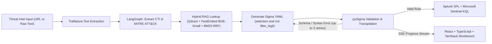

# Threat-Intel Sigma Agent

An autonomous **Agentic SecOps Pipeline** that transforms unstructured Cyber Threat Intelligence (threat advisory URLs or raw incident reports) into validated **Sigma YAML** detection rules, then deterministically transpiles them into **Splunk SPL** and **Microsoft Sentinel KQL**.

Built with **LangGraph**, **Google Gemini**, **Qdrant Hybrid Search** (`BAAI/bge-small-en-v1.5` + `Qdrant/bm25`), **pySigma**, **FastAPI (SSE)**, and a **React + TypeScript + TanStack** analyst workbench.

---

## Architecture



---

## Key Engineering Highlights

- **Hybrid RAG Field Grounding:** Combines dense semantic embeddings (`BAAI/bge-small-en-v1.5`) and sparse lexical matching (`Qdrant/bm25`) with Reciprocal Rank Fusion (`models.Fusion.RRF`) over 450 indexed **SigmaHQ** rules (`process_creation`, `file_event`, and `linux`) in local embedded Qdrant. Grounding the LLM in real SigmaHQ schemas prevents hallucinated log field names.
- **Deterministic `pySigma` Guardrails:** Every generated rule is stripped of markdown fences, parsed into **fresh per-backend `SigmaCollection` instances** (preventing in-place `sysmon_pipeline()` mutations from leaking across backends), compiled to **Splunk SPL** (`SplunkBackend` + `sysmon_pipeline()`) and **Microsoft Sentinel KQL** (`sigma.backends.microsoft365defender`), and fed back to the LLM for up to 3 self-correction retries on any `SigmaError` or `YAMLError`.
- **Real-Time SSE Streaming UI:** FastAPI streams per-node LangGraph execution updates over `POST /api/v1/generate/stream` (`text/event-stream`) to a Vite + React + TypeScript workbench featuring live stage badges, one-click threat presets, copyable multi-SIEM query tabs, and interactive `@tanstack/react-table` views for grounded SigmaHQ rules and extracted MITRE ATT&CK indicators.

---

## Tech Stack

| Layer | Technology |
| :--- | :--- |
| **Backend & Orchestration** | Python 3.13, FastAPI, Uvicorn, Pydantic v2, LangGraph, `langchain-google-genai` (`gemini-4-hydrogen`), Trafilatura |
| **Hybrid RAG & Embeddings** | Qdrant (local embedded `./qdrant_db`), FastEmbed (`BAAI/bge-small-en-v1.5` dense + `Qdrant/bm25` sparse, RRF fusion) |
| **Detection Engineering** | `pySigma` 2.1+, `pysigma-backend-splunk`, `pysigma-backend-microsoft365defender`, `pysigma-pipeline-sysmon`, SigmaHQ rules |
| **Frontend Workbench** | Vite, React 18, TypeScript, Tailwind CSS v4, `@tanstack/react-query`, `@tanstack/react-table`, Lucide Icons |
| **Deployment & Testing** | Docker, Docker Compose, Nginx (SSE-ready reverse proxy), `pytest`, `httpx` (`ASGITransport`) |

---

## Project Structure

```text
threat-intel-sigma-agent/
├── .agents/
│   └── skills/
│       └── sigma-rule-engineering/
│           └── SKILL.md           # pySigma 2.1+ & Sigma YAML standards
├── backend/
│   ├── app/
│   │   ├── graph/
│   │   │   ├── state.py           # LangGraph TypedDict shared state
│   │   │   ├── nodes.py           # extract_cti, rag_grounding, generate_sigma, validate_sigma
│   │   │   └── workflow.py        # StateGraph + <= 3 retry loop
│   │   ├── rag/
│   │   │   ├── ingest_sigma.py    # Shallow-clone SigmaHQ & index into Qdrant
│   │   │   └── retriever.py       # Hybrid dense + BM25 RRF search
│   │   ├── tools/
│   │   │   ├── cti_fetcher.py     # URL / raw-text extraction via trafilatura
│   │   │   └── sigma_engine.py    # pySigma validation + SPL & KQL compilation
│   │   ├── main.py                # FastAPI endpoints (/generate, /generate/stream, /health)
│   │   └── schemas.py             # Pydantic models (ExtractedCTI, ValidationResult, etc.)
│   ├── tests/                     # Pytest suite (sigma engine, CTI fetcher, RAG, workflow & API)
│   ├── .env.example
│   ├── Dockerfile
│   ├── pytest.ini
│   └── requirements.txt
├── frontend/
│   ├── src/
│   │   ├── api/streamGenerate.ts  # SSE fetch stream parser
│   │   ├── components/            # TanStack Table panels
│   │   ├── App.tsx                # SOC Workbench UI
│   │   └── presets.ts             # One-click threat-intel demo presets
│   ├── Dockerfile                 # Multi-stage Vite build -> Nginx
│   ├── nginx.conf
│   └── package.json
├── AGENTS.md
├── docker-compose.yml
└── .gitignore
```

---

## Quickstart

### 1. Clone & Configure Environment

```bash
git clone https://github.com/PaladaPayasam/threat-intel-sigma-agent.git
cd threat-intel-sigma-agent
cp backend/.env.example backend/.env
```

Edit `backend/.env` and set your Gemini API key:

```env
GOOGLE_API_KEY=your_gemini_api_key_here
```

### 2. Set Up Backend Virtual Environment & Build the Hybrid RAG Index

```bash
cd backend
python -m venv .venv
# Linux / macOS: source .venv/bin/activate
# Windows PowerShell: .\.venv\Scripts\Activate.ps1
pip install --upgrade pip
pip install -r requirements.txt

# Shallow-clone SigmaHQ/sigma and index 450 rules into ./qdrant_db
python -m app.rag.ingest_sigma --max-rules 450
```

### 3. Run Locally (Dev Mode)

**Backend (FastAPI on port `8000`):**

```bash
cd backend
uvicorn app.main:app --reload --port 8000
```

**Frontend (Vite on port `5173`):**

```bash
cd frontend
npm install
npm run dev
```

Open [http://localhost:5173](http://localhost:5173) in your browser.

### Or Run with Docker Compose

Ensure `backend/.env` and `backend/qdrant_db` exist (after running Step 2 once), then from the project root:

```bash
docker compose up --build
```

- **Frontend Workbench:** [http://localhost:5173](http://localhost:5173)
- **Backend API / Docs:** [http://localhost:8000/docs](http://localhost:8000/docs)

### 4. Run Tests

```bash
cd backend
pytest -v
```

---

## Example Output

**Threat Intel Snippet:**
> Adversaries executed `powershell.exe -EncodedCommand` to decode and drop `AppData\Local\Temp\updater.exe`, then created persistence via `schtasks.exe /Create /TN SystemUpdater /SC ONLOGON`.

**Generated & Validated Sigma YAML (excerpt):**
```yaml
title: Encoded PowerShell Payload Drop and Scheduled Task Persistence
status: experimental
tags:
  - attack.execution
  - attack.t1059.001
  - attack.persistence
  - attack.t1053.005
logsource:
  category: process_creation
  product: windows
detection:
  selection:
    - Image|endswith: '\powershell.exe'
      CommandLine|contains:
        - '-EncodedCommand'
        - ' -enc '
    - Image|endswith: '\schtasks.exe'
      CommandLine|contains|all: ['/Create', '/TN', 'SystemUpdater', '/SC', 'ONLOGON']
  filter_legit:
    ParentImage|startswith:
      - 'C:\Program Files\'
      - 'C:\Windows\CCM\'
  condition: selection and not filter_legit
level: high
```

**Compiled Splunk SPL:**
```spl
EventID=1 ((Image="*\\powershell.exe" (CommandLine IN ("*-EncodedCommand*", "* -enc *"))) OR (Image="*\\schtasks.exe" CommandLine="*/Create*" CommandLine="*/TN*" CommandLine="*SystemUpdater*" CommandLine="*/SC*" CommandLine="*ONLOGON*")) NOT (ParentImage IN ("C:\\Program Files\\*", "C:\\Windows\\CCM\\*"))
```

**Compiled Microsoft Sentinel KQL:**
```kql
((Image endswith "\\powershell.exe" and (CommandLine contains "-EncodedCommand" or CommandLine contains " -enc ")) or (Image endswith "\\schtasks.exe" and (CommandLine contains "/Create" and CommandLine contains "/TN" and CommandLine contains "SystemUpdater" and CommandLine contains "/SC" and CommandLine contains "ONLOGON"))) and (not((ParentImage startswith "C:\\Program Files\\" or ParentImage startswith "C:\\Windows\\CCM\\")))
```
